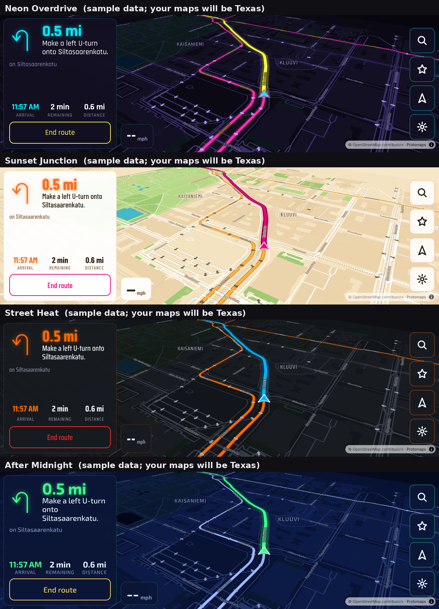

# Pi4B Headunit

CarPlay / Android Auto + themed offline navigation on a Raspberry Pi 4B.



Parts lists (with links and wiring pinouts):
- F-250 and Miata, three budget tiers: [`docs/Pi_HeadUnit_Parts_List.xlsx`](docs/Pi_HeadUnit_Parts_List.xlsx)
- 2017 Nissan Frontier SV, double-DIN + factory backup camera, three budget tiers: [`docs/Frontier_2DIN_Parts_List.xlsx`](docs/Frontier_2DIN_Parts_List.xlsx)

| Vehicle | Profile | Screen | Extras |
|---|---|---|---|
| 1997 Ford F-250 7.3L (crew cab) | `f250` | Waveshare 7.9" 1280×400 over the single-DIN opening | 60 s key-off delay for the diesel |
| 1997 Mazda Miata | `miata` | Waveshare 7.9" 1280×400 over the single-DIN opening | 2 speakers, power antenna |
| 2017 Nissan Frontier SV | `frontier` | Tier 3: 7" 1024×600 900-nit Orient Display. Tiers 1–2: Raspberry Pi Touch Display 2. Double-DIN | **factory backup camera** (tiers 2–3), steering-wheel controls (tier 3) |

All run on a Raspberry Pi 4B (4 GB).

| Piece | What does it |
|---|---|
| CarPlay (wired and wireless) | Hudiy + Carlinkit CPC200-CCPA dongle |
| Android Auto (wired and wireless) | Hudiy, built in (your passengers' Android phones) |
| Themed offline navigation, four map skins | `apps/nav`: MapLibre + Protomaps map tiles + Valhalla routing |
| iPod Nano (1st gen and later) / USB music | `apps/music`: MPD reads the song tags, so scrambled iPod file names never show |
| AM/FM radio | `apps/radio` (AM + FM via RTL-SDR Blog V4), plus Hudiy's own FM player with RDS |
| Settings: skin, display, driving, region & language, maps, updates, developer (terminal, SSH), test logs | `apps/theme`, `bin/hu-system.sh` |
| Ignition-safe power (no SD card corruption) | `bin/hu-power.py` + relay latch, or CarPiHAT |

The four skins are **original designs** inspired by the mood of driving-game maps. They copy no
game artwork, logos or fonts: Neon Overdrive (cyberpunk neon), Sunset Junction (sunny open-world),
Street Heat (underground street racing), After Midnight (deep-blue night city).

---

## 1. Install: pick one way

### A. Ready-to-flash image (recommended)
Download *Raspberry Pi OS (64-bit) with desktop* (`.img.xz`) into `out/cache/`, then:
```bash
python3 -m pip install pyfatfs
python3 image/make-image.py --base out/cache/<raspios file>.img.xz --vehicle miata [--hudiy <installer>] [--set DISPLAY_TYPE=monitor]
```
(No Python? `./image/build-image.sh` takes the same options and runs it in Docker.)
Only the FAT boot partition is edited: the project goes to `bootfs/headunit/package`, along with a
one-time `firstrun.sh` hook in `cmdline.txt`.

1. Flash with **Raspberry Pi Imager**: *Choose OS → Use custom*. When Imager offers **OS
   customisation, choose No**. The image sets everything itself, and Raspberry Pi's setup wizard never appears:
   - user **headunit**, password **headunit**, logged in to the desktop automatically
   - United States, American English (`en_US.UTF-8`), time zone America/Chicago, US keyboard
   - network name `<vehicle>-headunit` (for example `miata-headunit.local`)
2. Before you eject, open the **bootfs** drive → `headunit/headunit.conf` to change any of those, and add
   Wi-Fi (`WIFI_SSID`/`WIFI_PSK`), the phone hotspot, and `DISPLAY_TYPE=monitor` for a bench monitor.
   For Hudiy, put `hudiy_installer.tar.gz` from your order email in `headunit/hudiy/` (or pass `--hudiy` to
   make-image.py) and your **order number** in `HUDIY_ORDER="#…"`. Hudiy's installer asks for the order
   number and checks it online (that's its license check); first boot answers that prompt for you, then
   deletes the installer and the order number from the card.
3. Boot the Pi on the bench, within range of Wi-Fi. The first power-up sets up the user and region, then
   reboots. The second boot installs Hudiy, then the add-ons, and reboots into Hudiy; the maps download in the background afterwards
   (CarPlay / Android Auto starts by itself). This takes **15–45 minutes**. The log is
   `bootfs/headunit/firstboot.log`. Passwords in `headunit.conf` are erased from the card once they're used.
4. Change the password: *Settings → Developer → Open terminal*, then type `passwd`.

**Blank screen or something not working?** Put the SD card in your computer and open
`bootfs/headunit/diag.txt`: about 90 s after every boot the Pi writes a report there (screens, what's
running, failed services, recent errors). Passwords and the Hudiy order number are left out. Delete
`bootfs/headunit/collect-diagnostics` to stop the reports; create an empty file with that name to turn them
back on. While first-boot setup runs, a terminal window on the desktop shows its progress. The offline map
download starts in the background after setup (Settings → Maps shows progress), so Hudiy doesn't wait for it. Desk monitors larger than 1920×1080 (Hudiy's limit) are switched to a mode that fits when
`DISPLAY_TYPE=monitor`.

Country, language (10 languages: English, Spanish, Chinese, Tagalog, Vietnamese, Arabic, French,
Korean, Portuguese, Hindi) and time zone can be changed any time in *Head Unit Settings → Region &
language*. The head-unit screens and spoken directions switch right away; the Raspberry Pi desktop and
Hudiy pick up the language at the next start. Translations are in `apps/common/i18n.json`.

### B. Stock Raspberry Pi OS + setup script (to see each step)
1. Flash **Raspberry Pi OS (64-bit) with desktop** using Imager (here, do use Imager's OS customisation for user, Wi-Fi and region).
2. Install Hudiy following its email instructions.
3. Copy this folder to the Pi and run:
```bash
sudo ./setup.sh --vehicle f250 --tier 2          # or: --vehicle miata, --tier 1|2|3, --region us
```
`setup.sh` runs the short, commented stages in `setup.d/` in order:

| Stage | What it changes |
|---|---|
| `10-packages` | apt packages (mpd, gpsd, espeak-ng, hfsplus…) and a Python venv with pyvalhalla |
| `20-display` | screen timings, rotation (console + kanshi), touch mapped to HDMI-A-1, no blanking, desktop autologin |
| `30-power` | `gpio-poweroff` hold pin, I2C off (GPIO3 is the ignition sense), power daemon |
| `40-audio` | USB audio output preferred over HDMI (WirePlumber rule) |
| `45-dimmer` | screen dimmer service (backlight, HDMI DDC/CI, or overlay), backlight permissions, i2c-dev |
| `50-gps` | gpsd with USB auto-detect |
| `60-media` | iPod/USB auto-mount (read-only) + MPD as a user service |
| `70-radio` | RTL-SDR (tier 3 only) |
| `80-nav` | data folders, bridge service, map updater, a two-line sudoers rule |
| `85-updates` | signed software updates from GitHub: check timer, Wi-Fi hook, install-at-key-on + rollback services |
| `75-camera` | backup camera (Frontier): v4l/GStreamer, `/dev/hu-rearcam` for the USB capture stick, set to NTSC |
| `77-swc` | steering-wheel controls (Frontier): SPI on, `python3-spidev`, `headunit-swc` service |
| `90-hudiy` | adds a **Drive** menu to Hudiy (Navigation, iPod & USB, AM/FM Radio, Head Unit Settings); Android Auto GPS → gpsd |

Every stage can be run again safely: system files are only edited inside `# >>> headunit:` blocks.
To redo one stage: `sudo /opt/headunit/setup.sh --only 20-display`.
To change settings later: edit `/etc/headunit/headunit.conf`, then re-run `sudo /opt/headunit/setup.sh`.

---

## 2. Maps (whole US or Texas + neighbors; update any time)

There are two kinds of map data:

| Data | Made where | How to update |
|---|---|---|
| **Map display** (the themed picture) | Downloaded by the Pi from the daily OpenStreetMap build at Protomaps, cut to your region | *Settings → Maps → Update maps now* on Wi-Fi, or `sudo systemctl start headunit-update-maps` |
| **Routing + search** | Built on your Mac or PC (too heavy for the Pi) | `maps/build-routing.py`, then a USB stick |

Building routing + search on a computer:
```bash
python3 -m venv hu-maps && source hu-maps/bin/activate      # Windows: hu-maps\Scripts\activate
pip install pyvalhalla==3.9.1 osmium
python3 maps/build-routing.py --region texas-plus           # TX, LA, OK, NM, AR (about 30-60 min)
python3 maps/build-routing.py --region us --no-addresses    # whole US: use the Windows PC (16 GB+ RAM, a few hours)
```
Copy the resulting `HEADUNIT_MAPS` folder onto any USB stick and plug it into the head unit. It
imports by itself. Sizes (estimates): texas-plus is about 3–6 GB in total, and the whole US is about
30–45 GB (the 256 GB card in tier 3). Regions are defined in `maps/regions.json`.

---

## 3. Wiring

Full harness pinouts and the parts for each tier are in the parts-list spreadsheet (tabs
*Wiring F-250* and *Wiring Miata*). The Pi side:

| Pi pin | Use |
|---|---|
| GPIO3 (pin 5) | ACC / ignition sense from the optocoupler (active low). It also wakes a halted Pi |
| GPIO4 (pin 7) | Dash-light sense (night dimming) |
| GPIO26 (pin 37) | Power hold → relay module CH1 (`gpio-poweroff`; drops only after a clean halt) |
| GPIO27 (pin 13) | Amp remote turn-on → relay CH2 |
| GPIO22 (pin 15) | Power antenna → relay CH3 (raised only while the radio plays) |

**Tier 3 (TJD CarPiHAT)** uses the HAT's own pins instead (from its
[Quick Start Guide](https://github.com/gecko242/CarPiHat/wiki/Quick-Start-Guide)): ignition sense GPIO12
(high = key on), power latch GPIO25, illumination GPIO13, 12V outputs OUT_0 = GPIO27 (amp remote) and
OUT_1 = GPIO22 (power antenna), and its real-time clock on I2C (DS1307 on boards v0.4–0.6; set `RTC=ds3231`
for a v0.3 board, `RTC=none` without one). The ignition wire switches the HAT's 12V supply on by itself, and
the Pi keeps the latch until it has shut down.
| GPIO5 (pin 29) | Reverse sense (Frontier) → shows the backup camera through Hudiy's API |

How the power sequence works:
- Key on: the relay latches and the Pi boots. The amp switches on 6 seconds later, so there's no pop.
- Key off: the amp cuts out right away, then a countdown starts. It's **60 s on the F-250**, so a
  stall, restart or long glow-plug wait doesn't power-cycle the head unit, and **20 s on the Miata**.
  When the countdown ends, the Pi shuts down cleanly and then releases its own power.
- The power daemon only arms after it has seen the key **on** once, so a Pi on the bench never
  shuts itself off.
- **Tier 3 (CarPiHAT):** the pins above are set automatically (`TIER3` in `config/tiers.conf`); check
  them against your board's revision before the first drive.
- **Bench testing without the ignition wire:** set `POWER_MODE=none`.

Before connecting anything, **meter every factory wire** with the key off, the key on, and the
lights on.

---

### Screen dimming (all vehicles)
Head Unit Settings → **Display**: a brightness slider, or auto-dim with separate **Day** and **Night**
levels that switch on the dash-light (headlight) wire. `hu-dimmer` picks the best method each screen supports:

| Screen | Method | What it changes |
|---|---|---|
| Raspberry Pi Touch Display 2 | backlight (`/sys/class/backlight`) | the real backlight |
| HDMI screen that answers DDC/CI (likely the Orient Display; checked at startup) | `ddcutil setvcp 10` | the screen's own backlight |
| Anything else (Waveshare 7.9") | click-through black overlay above all apps, including Hudiy and CarPlay | the picture (taps pass through) |

Backlight methods go down to 5%; the overlay stops at 20% so the screen never goes unreadably black.

### Backup camera (Frontier)
Factory Nissan camera → Axxess AXBUCS-NI326V (powers the camera with 6 V) → RCA → USB capture stick
(UTV007/STK1160) → Hudiy's reverse-camera view. When reverse is selected, `hu-power` tells Hudiy to show
the camera right away (`SetReverseCameraStatus` over Hudiy's local API, port 44405). It hides the camera
2 s after you leave reverse, so a three-point turn doesn't flicker. The camera only shows while the key is on.

### Steering-wheel controls (Frontier)
The wheel buttons are a resistor ladder: each button connects a key wire to ground through a
different resistor. Each key wire gets a 1 kΩ pull-up to 3.3 V, so every button produces its own
voltage, which an MCP3008 ADC on the SPI bus reads.

Think of it like a dimmer switch with fixed clicks: the Pi doesn't see "which button", only "how much
voltage", so it learns the click positions for your wheel once instead of trusting a generic table.
That's also why it works on other cars with resistive wheel controls.

```bash
sudo /opt/headunit/bin/hu-swc.py --raw      # wiring check: live values; each button should move one channel
sudo /opt/headunit/bin/hu-swc.py --learn    # key ON; press and hold each button when asked
sudo systemctl restart headunit-swc
```
Default actions: volume up/down (repeat while held), next/previous track, mode → home screen,
mute, answer, hang up. Change any of them in `/etc/headunit/headunit.conf`, for example
`SWC_ACTION_MODE=applications_menu`.

## 4. 3D-printed mount (`cad/`)

`python cad/headunit_mount.py` builds the single-DIN set (F-250, Miata) into `cad/print/1din-waveshare79/`.
`python cad/headunit_mount.py 2din-7in` builds the Frontier double-DIN set for the Orient Display into `cad/print/2din-7in/`.
`python cad/headunit_mount.py 2din-pitouch2` builds the Frontier set for the Pi Touch Display 2 (tiers 1–2).

All four parts print **without supports** on the P1S in ASA:

| Part | Orientation | Notes |
|---|---|---|
| `1_bezel` | Face **down** on the textured PEI plate | The visible finish. Six M3 heat-set inserts in the back |
| `2_spacer_ring` | Flat | Room for the screen's driver board; clamps the glass |
| `3_back_and_sled` | Plate down, tube straight up | Add a 5 mm brim (tall ASA part). M5 slots for your dash bracket |
| `4_pi_tray` | Flat | Pi 4 standoffs (M2.5), strap slots for an armor case, M3 grid for the relay/converter modules |

Print settings: Bambu ASA profile, 0.2 mm layers, 6 walls (2.4 mm), 25% gyroid infill, enclosure
closed, aux fan off, and let the part cool in the chamber. Put the inserts in at about 245 °C.

**Measure your screen with calipers first.** The screen numbers at the top of
`cad/headunit_mount.py` are estimates from comparable panels. Change them and re-run
`python headunit_mount.py`, or edit the STEP files in Inventor.

---

## 5. Test drives and tuning

Everything is logged to `~/headunit-data/usage/*.jsonl`: taps, routes, reroutes, skin changes,
map frame rate, errors, and power events. To collect the logs, plug in a USB stick **named
HUEXPORT**; the logs copy onto it within a few seconds. Wait 10 seconds before you unplug it.

Bench-test the navigation without driving: open
`http://127.0.0.1:8765/apps/nav/index.html?sim=15`, long-press the map, and tap **Go**. The car
then drives the route by itself at about 35 mph.

---

## 6. Software updates (push from your Mac, the cars pick it up)

**Publish an update** from your Mac:
```bash
cd ~/Documents/Pi4B_HeadUnit
tools/release.sh 1.2.0 "Bigger turn arrows, faster search"
```
This sets `VERSION`, commits, creates the tag `v1.2.0` signed with your release key, checks the
signature the same way the Pi will, and pushes to GitHub.

**What each head unit does:**
1. Every 30 minutes, and whenever Wi-Fi connects (home Wi-Fi first, your phone's hotspot as the
   backup), it asks GitHub for tags newer than the version it runs. A check costs a few KB and a
   download is about 4 MB.
2. It accepts a tag only if it is signed by a key in `config/release-signers`. Unsigned tags,
   other keys, renamed old tags, and releases whose `VERSION` file disagrees with the tag are
   refused, and refused versions are never fetched again.
3. It downloads the release into `/opt/headunit-releases/X.Y.Z` (and any new Debian packages, so
   installing later doesn't need internet). Nothing changes while you drive.
4. At the next key-on, before the screen starts, it points `/opt/headunit` at the new folder and
   re-runs `setup.sh`. This adds about a minute to that one startup.
5. Once the desktop is up, it checks that the head-unit apps answer and report the new version.
   If they don't come up within 4 minutes, or the Pi loses power three times before they do, it
   goes back to the previous version and blacklists the new one.

Settings → **Updates** shows the version, the last check and any download waiting to install, and
has a *Check now* button. The log is `/var/log/headunit-update.log`. `UPDATES=0` in
`/etc/headunit/headunit.conf` turns the checks off.

**Your release key:** create it once with
`ssh-keygen -t ed25519 -C "headunit-release" -f ~/.ssh/headunit_release`. Its `.pub` line goes in
`config/release-signers`. The private key never leaves your Mac. To change keys, add the new key in
a release signed with the old one. Pis trust the key list of the last version that started correctly.

**Wi-Fi:** set `HOTSPOT_SSID` and `HOTSPOT_PSK` in `headunit/headunit.conf` before the first boot. To
add or change a network later, use
`sudo nmcli con add type wifi con-name hu-phone-hotspot ssid "NAME" wifi-sec.key-mgmt wpa-psk wifi-sec.psk "PASSWORD" connection.autoconnect-priority -10`.
The Pi's Wi-Fi joins networks as a client (`PI_WIFI=client`), so Hudiy's own hotspot for wireless
Android Auto stays off. CarPlay uses the Carlinkit dongle's Wi-Fi, and Android phones work over a
USB cable. `PI_WIFI=hudiy-hotspot` turns Hudiy's hotspot back on, but then updates can't use Wi-Fi.

**What isn't updated this way:** Hudiy (it has its own updates), Raspberry Pi OS (`sudo apt full-upgrade`
when you choose), and maps (Settings → Maps).

---

## 7. Security notes
- The bridge listens on **127.0.0.1 only**, so nothing on Wi-Fi can reach it.
- Software updates install only if they are signed by your release key. The updater and the key list
  run from a known-good copy in `/usr/local/lib/headunit` that is replaced only after a new version
  has started correctly, so a broken release can't disable rollback.
- Wi-Fi passwords in `headunit.conf` are erased from the card's boot partition after first boot.
- The head-unit apps get root only through `/etc/sudoers.d/headunit`: start the map updater, start an
  update check, import a map pack from `/media/hu/*/HEADUNIT_MAPS`, and `bin/hu-system.sh` (country,
  time zone, language, SSH on/off; every argument is checked against a fixed list or the system's tables).
- The image's default login is `headunit` / `headunit`, like Raspberry Pi OS's own first user it has
  `sudo` without a password. SSH is **off** by default; Settings → Developer warns while the default
  password is still in use. Change it with `passwd` before turning SSH on.
- USB drives mount **read-only** with `noexec,nosuid,nodev`. The one exception is a stick labeled
  HUEXPORT, which is used to export logs.
- Hudiy is closed source. Everything in this folder is plain text you can read.

## 8. Rebuilding the web assets (only if you change themes)
```bash
cd tools && npm install && npm run build      # fonts, styles, sprites, maplibre/pmtiles
```
Skin colors live in `tools/themes.json`.

## Credits and licenses
Map data © OpenStreetMap contributors (ODbL), tiles via Protomaps. Routing: Valhalla (MIT).
Map rendering: MapLibre GL JS (BSD-3). Fonts: Rajdhani, Barlow Condensed, Saira Condensed, Exo 2,
Orbitron (SIL OFL). Hudiy is a separate commercial product (wiboma).
